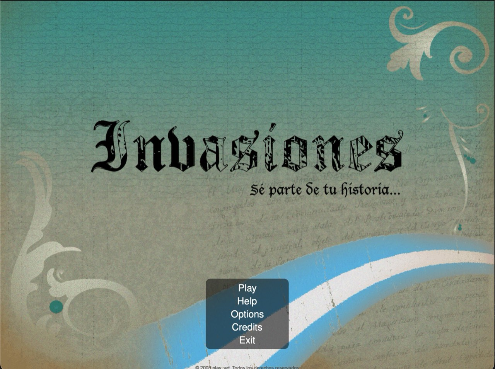
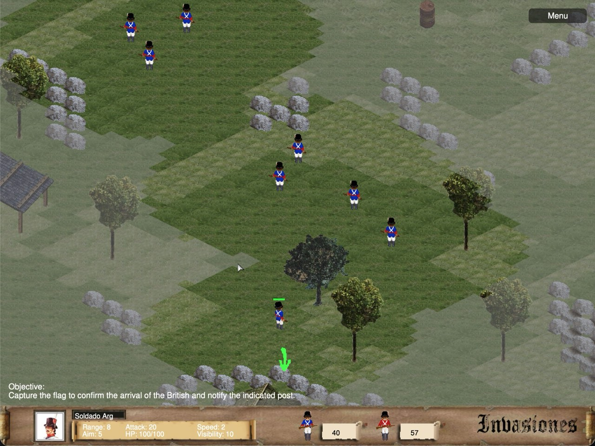
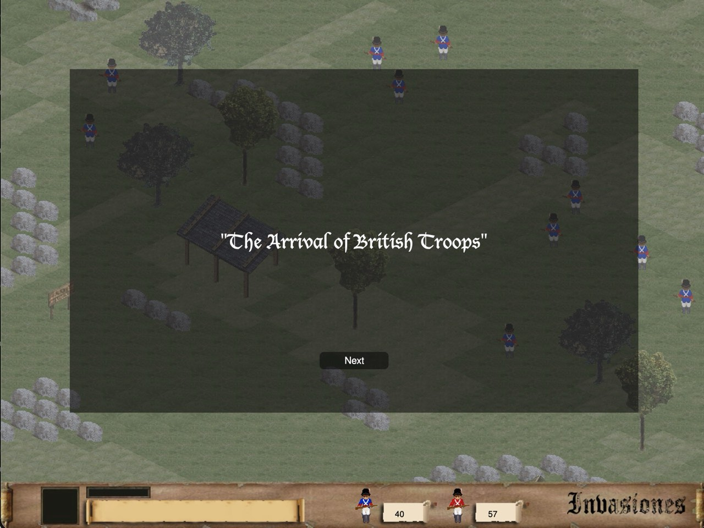
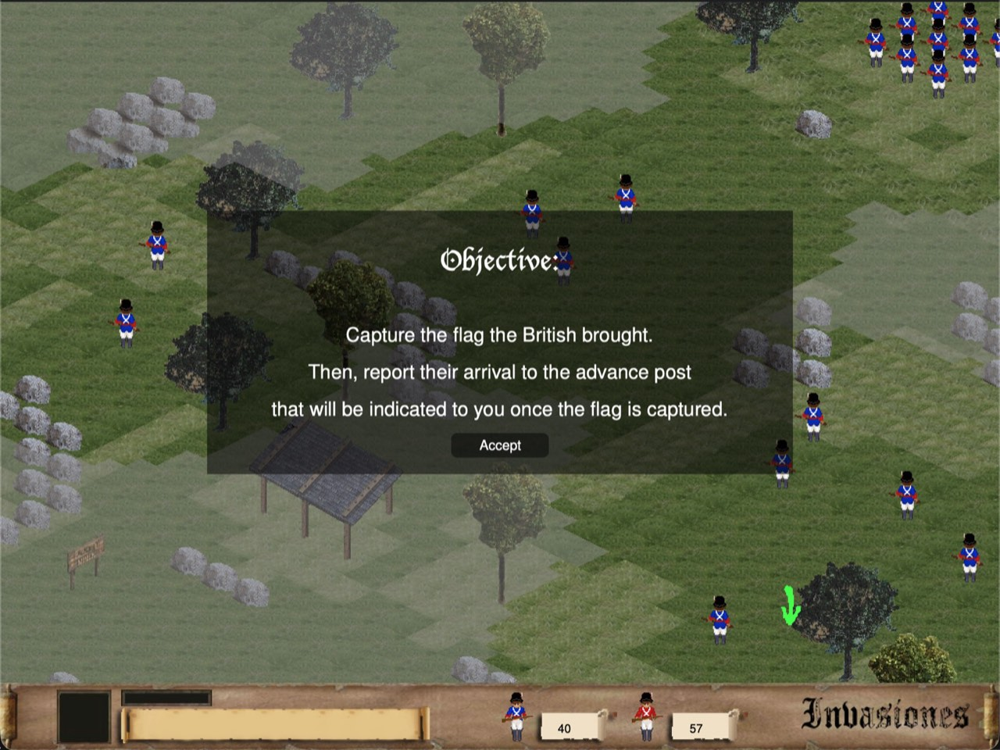

# Invasiones macOS port

[](https://swift.org)
[](https://developer.apple.com/macos/)
[]()
[](https://github.com/luciavmf/invasiones-macos/actions/workflows/macos-build.yml)

This is a port of the original Windows game ([luciavmf/invasiones](https://github.com/luciavmf/invasiones), folder `Juego/`) to macOS, built with Swift and SpriteKit.

The original game was written in C# for Windows, with all code in Spanish (`Unidad`, `Grupo`, `Mapa`, `Orden`, etc.). This port translates everything to English and adapts the SDL-based rendering and input systems to native macOS APIs via SpriteKit.

The port is being developed with the assistance of [Claude Code](https://claude.ai/code), Anthropic's AI coding tool, which is helping with the translation from C# to Swift, debugging, and Swiftification of the codebase.

## Screenshots

| Main Menu |
|-----------|
|  |
| **Gameplay** |
|  |
| **Battle Intro** |
|  |
| **Objectives** |
|  |

## Download

Every push to `main` builds, signs, and notarizes the app, then publishes it as a DMG on the [latest release](https://github.com/luciavmf/invasiones-macos/releases/tag/latest-macos-build).

## Building from source

Requires Xcode with the macOS 26.4 SDK or later.

```sh
xcodebuild -scheme Invasiones -project Invasiones/Invasiones.xcodeproj build
xcodebuild -scheme Invasiones -project Invasiones/Invasiones.xcodeproj test
```

Or open `Invasiones/Invasiones.xcodeproj` in Xcode and press <kbd>⌘</kbd> <kbd>R</kbd>. Debug builds run windowed; Release builds run fullscreen.

## Cheat codes

Cheats are only active during gameplay (not in menus). Each code is entered one key at a time — pressing any other key resets all sequences.

| Sequence | Effect |
|----------|--------|
| <kbd>G</kbd> <kbd>A</kbd> <kbd>N</kbd> <kbd>X</kbd> <kbd>W</kbd> | Instant win — jumps to the victory screen |
| <kbd>P</kbd> <kbd>E</kbd> <kbd>R</kbd> <kbd>X</kbd> <kbd>W</kbd> | Instant lose — jumps to the game over screen |
| <kbd>O</kbd> <kbd>B</kbd> <kbd>J</kbd> <kbd>X</kbd> <kbd>W</kbd> | Skip objective — advances to the next objective immediately |

Additionally, pressing <kbd>U</kbd> at any time during gameplay cycles the camera to the next Argentine unit.

## Data files

Game data lives in `Invasiones/data/`:

| File | Format | Purpose |
|------|--------|---------|
| `res.json` | JSON | Resource manifest — all asset paths, sprite and animation definitions |
| `strings.json` | JSON | Localised text strings, keyed by English snake_case identifiers |
| `nivel/nivel_N.xml` | XML | Level definitions (objectives, units, starting orders) |
| `nivel/orden_nv*.xml` | XML | Scripted AI movement orders |
| `unidades/*.csv` | CSV | Unit animation frame data |

`res.json` and `strings.json` replaced the original `res.xml` and `strings.xml` from the C# version. Map and level files remain XML because they use the [Tiled](https://www.mapeditor.org/) format (`.tmx`/`.tsx`).

## Other ports

- **TypeScript (web)**: [luciavmf/invasiones-web](https://github.com/luciavmf/invasiones-web), a browser port using PixiJS for rendering. [Play it in the browser](https://luciavmf.github.io/invasiones-web/).

## Continuous integration

GitHub Actions builds, signs, and notarizes the app on every push to `main`. See [docs/ci.md](docs/ci.md) for how it works and the secrets it needs.
